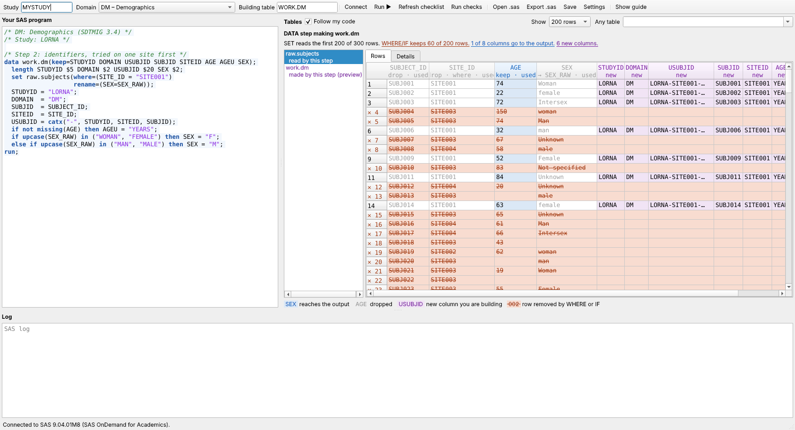
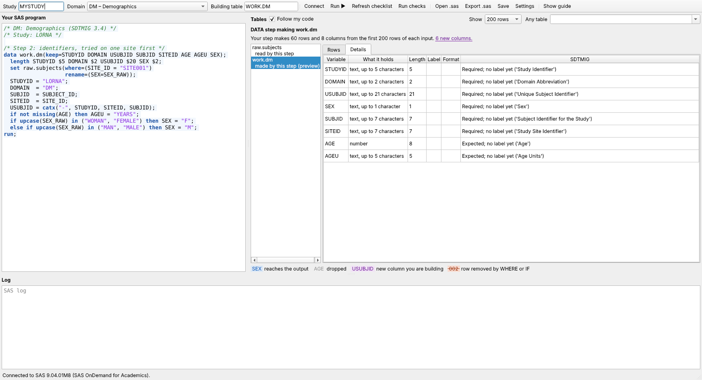
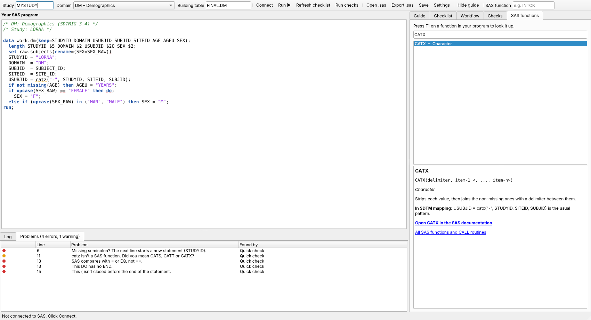

# SDTM Helper

A guide for SAS clinical programmers who map clinical trial data to CDISC SDTM.

SDTM Helper **does not write your mapping programs**. You write every line of SAS yourself. The app reads the standards and the tables you have loaded in SAS, then tells you what each domain needs, tracks what is left to do, and runs light checks when you finish.

Targets: **SDTMIG v3.4** and **SDTM v2.0**, with SAS 9.4 through SAS OnDemand for Academics (SAS 9.4 Desktop support is planned).

## Plan

| Step | What it delivers | Status |
|---|---|---|
| 1. Foundation | SAS connection through SASPy, local SDTMIG and controlled terminology, saved progress | Done |
| 2. Domain guidance (DM first) | You choose the domain; the app explains each variable (for example ISO 8601 dates, how RFSTDTC is derived), shows a checklist of what is missing and a workflow chart, and saves your progress | Done |
| 3. P21-lite checks | Small, fixable conformance checks at the end of each domain | Done |
| 4a. Guidance for all domains | Shared workflows and tips for Events, Interventions and Findings domains, plus specific tips for AE, MH, DS, CM, EX, VS and LB | Done |
| 4b. Windows app | Desktop window with SAS editor and guide panel, Windows installer, SAS 9.4 on your PC | Done |

## The desktop app



The window has your SAS program with the **tables** beside it, the SAS log underneath, and the guide on the right (F9 hides it for more room).

- **Follow my code** (on by default) works like SQLens: put the cursor in a DATA step or a `CREATE TABLE … AS SELECT` and, a moment after you stop typing, the tables that step reads and makes appear beside it. You don't need to run anything.
  - Blue columns reach the output, grey ones are dropped, and purple columns on the right are the new ones you are building, already filled in with the values they will get.
  - Struck-through rows (marked ✕) are the ones your `WHERE` or subsetting `IF` removes.
  - Small words under each heading say how the step uses the column: keep, drop, where, used, by, join, → new name. Hover a heading for the SDTMIG label and Core, and for a new column, your expression.
  - A line above the table sums it up, for example "WHERE/IF keeps 60 of 200 rows. 6 new columns."
  - To do this, the app runs a copy of your step on the first 100 to 1000 rows (**Show**) of each input, writing only to `WORK._SDTMH_*` tables. Your own tables are never changed. Steps that write files, run commands, use `MODIFY`, `SELECT INTO :` or `UNION` are not followed; run those with F3.
- **Details** lists each variable of the table: what it holds in plain words, length, label and format, and what SDTMIG expects (Core, text or number, the right label).
- **Any table** shows the first rows of any table, for example your finished `FINAL.DM` after a run. Red headers are Required variables, shaded cells are empty Required values, grey headers aren't in the domain.



### Problems as you type, and SAS function lookup



- **Squiggly underlines**, like PyCharm: red for errors, amber for warnings. Hover over one to read the message. The **Problems** tab under the editor lists them all; double-click one to jump to it.
  - A **quick check** runs as you type, without SAS: a missing semicolon, an unclosed quote, comment or bracket, a DO or SELECT without END, `==` or `!=` (SAS uses `=`/`EQ` and `^=`/`NE`), a misspelt function ("catz isn't a SAS function. Did you mean CATS, CATT or CATX?"), and a last step without RUN or QUIT.
  - **SAS's own errors and warnings** are underlined too, at the column SAS marks in the log, after each Run (F3) and each time Follow my code runs your step. "Variable … is uninitialized" notes show as warnings, since they usually mean a misspelt or dropped variable. They clear when you change that line.
- **SAS functions**: type a function in the **SAS function** box in the toolbar, or press **F1** on a function in your program (CALL routines and % macro functions too). The **SAS functions** tab shows its syntax, a short summary and, for the common ones, how it is used in SDTM mapping, with a link to SAS's documentation. You can also search by topic, e.g. "date". SAS's documentation site has no links by function name, so the link opens a web search for the function's SAS Help Center page, which comes up as the first result.

The guide tabs:

- **Guide**: every variable of the domain, with its Core status, format, terminology and tips. Click one to read about it.
- **Checklist**: what is still missing or empty in the table you are building. It refreshes after each run (F5).
- **Workflow**: the order to work in, as a chart. Click a step to tick it off; blue is what to do next.
- **Checks**: the P21-lite report (F6), each finding with a suggested fix.

Pick your study and domain at the top and type the table you are building (e.g. `FINAL.DM`). **Run** (F3) submits your program, or just the selected lines, to SAS. Your program and ticked steps are saved per study and domain (Ctrl+S, and automatically when you switch or close).

### Install on Windows

1. Install Java (for example Eclipse Temurin from <https://adoptium.net/>).
2. Download `SDTM-Helper-Setup-<version>.exe` from the [Releases](https://github.com/dtb1000/Clinical-trial-mapping-tool/releases) page and run it.
3. Open SDTM Helper, click **Settings**, choose *SAS OnDemand for Academics* (with your home region and user ID) or *SAS 9.4 installed on this PC*, and check the Java path. Optionally pick your libname program to run after connecting.
4. Click **Connect**. For ODA the app asks for your password each time and never stores it.

To run it from source instead: `pip install -e .[app]`, then `sdtm-helper-app` (or `python -m sdtm_helper.app`).

### Making a release

Push a tag such as `v0.2.0`. GitHub Actions runs the tests on Windows, builds the app with PyInstaller, wraps it in an Inno Setup installer and attaches it to a new release. Every pull request also builds the installer as a downloadable artifact.

## Command line

The same features are available as commands, which is handy for scripting.

## Getting started

1. Follow [docs/saspy-setup-windows.md](docs/saspy-setup-windows.md) to connect to SAS OnDemand for Academics.
2. Download the controlled terminology (no key needed): `sdtm-helper fetch-ct`
3. Tell the app which domain you are mapping, and point it at the table you are building:

   ```
   sdtm-helper guide DM FINAL DM --study LORNA --autoexec path\to\libname.sas
   sdtm-helper explain DM RFSTDTC
   sdtm-helper step DM identifiers --study LORNA
   sdtm-helper guide DM --study LORNA --chart
   ```

   When the domain is finished, run the P21-lite checks (add `--dm FINAL.DM` for other domains, to check subjects and study days against DM):

   ```
   sdtm-helper check DM FINAL DM --study LORNA --autoexec path\to\libname.sas
   sdtm-helper check AE FINAL AE --dm FINAL.DM --study LORNA --autoexec path\to\libname.sas
   ```

   `guide` shows the workflow, your next step and a checklist of required and expected variables that are missing or empty. `step` ticks off a workflow step; progress is saved and picked up next time. `--chart` prints the workflow as a Mermaid flowchart.

## What P21-lite checks

Errors, warnings and notices, each with a suggested fix:

- Required or expected variables missing; required variables empty; variables that aren't in the domain (move them to SUPP--)
- Variable names over 8 characters, labels over 40, character lengths over 200, wrong type, labels that differ from SDTMIG, variable order
- ISO 8601 dates and durations (partial dates allowed), DOMAIN value, controlled terminology (after `fetch-ct`)
- One record per subject in DM, --SEQ unique within USUBJID, start after end
- DM rules: AGEU with AGE, DTHFL only "Y", ARMNRS when ARMCD is empty
- AE: serious events have a seriousness criterion. Findings: every result has a standard result, --STRESN matches --STRESC, no results on NOT DONE records
- Class variables the SDTM model allows (e.g. TAETORD in DS) are noted, not flagged as errors
- Against DM: every USUBJID exists in DM, --DY matches the date and RFSTDTC, no study day 0

The checks read your table through SASPy and never change it. They are a quick first pass, not a replacement for Pinnacle 21.

## Where the standards come from

- **Controlled terminology** comes from the public NCI EVS release files, so it needs no account.
- **SDTMIG variable metadata** ships with the app in `src/sdtm_helper/data/`. The CDISC Library API only serves SDTMIG to CDISC members, so the files are hand-built from SDTMIG v3.4 and verified against the published guide (see `src/sdtm_helper/data/README.md`). A maintainer with membership can replace them with `scripts/build_standards_bundle.py`. The app checks GitHub for newer releases and reminds the user to update.

Downloaded files are cached in `%USERPROFILE%\.sdtm_helper\standards`, and saved work in `%USERPROFILE%\.sdtm_helper\progress`.

## Development

```
python -m venv .venv
.venv\Scripts\activate
pip install -e .[dev]
pytest
```

The tests do not need SAS or a CDISC key.

Test data: the [LORNA Clinical Trial](https://github.com/dtb1000/LORNA-Clinical-Trial) project has raw data, SAS mapping programs and validated SDTM datasets that work well with this app.
